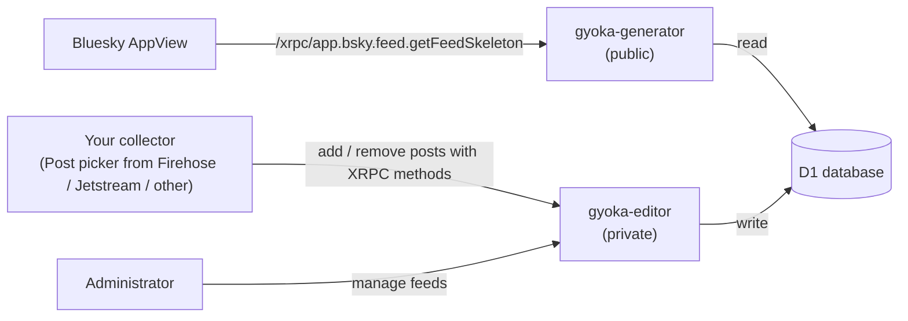

# Gyoka

Gyoka is an edge service for Bluesky custom [feed generators](#feed-generator).
It runs on Cloudflare Workers with a [D1](#d1) database.
It serves [feed skeletons](#feed-skeleton) to Bluesky [AppView](#appview) and provides APIs to manage posts for each feed.

- `gyoka-generator`: Public feed skeleton endpoint for Bluesky AppView.
- `gyoka-editor`: Private API to manage feeds and posts based on AT Protocol [Lexicon](#lexicon).

Terms such as AT Protocol and XRPC are explained in the [Glossary](#glossary).

## How it works



Gyoka stores posts in D1 per feed and serves them to AppView.
It does not find posts by itself; your [collector](#collector) decides which posts belong to each feed and sends them to the editor API.

| Gyoka provides                        | You prepare                                              |
| ------------------------------------- | -------------------------------------------------------- |
| Feed skeleton endpoint for AppView    | Collector that finds posts and calls the editor API      |
| Private API to manage feeds and posts | Cloudflare account (for production deployment)           |
| D1 schema and migrations              | Bluesky account or DID that publishes the feed generator |
| `did:web` documents for both Workers  | Administrator DIDs allowed to use the editor API         |

## Contents

- [How it works](#how-it-works)
- [Features](#features)
- [Requirements](#requirements)
- [Install](#install)
- [Development](#development)
- [Deploy to Production](#deploy-to-production)
- [Repository Structure](#repository-structure)
- [Glossary](#glossary)
- [License](#license)

## Features

### Highlights

- **Edge-native**: Runs globally on Cloudflare Workers, so Bluesky/AppView requests can be served with low latency.
- **Decoupled architecture**: Feed serving and post collection are independent.
  AppView calls only the generator endpoint, while collector logic stays behind the private editor API.
- **Multi-feed operation**: You can manage many feeds from one deployment.
- **AT Protocol support**:
  - Feed generator [DID document](#did-and-did-document) endpoint
  - Feed skeleton pagination
  - Language tag filtering by request headers
  - [Service JWT](#service-jwt) verification with cached DID document resolution
- **Practical management API**: Manages feeds through [XRPC](#xrpc) endpoints on `editor`.
  Supports batch add/remove, remove-by-author, feed trimming, and active/inactive control.

### Generator endpoints

- `/xrpc/app.bsky.feed.getFeedSkeleton`
- `/xrpc/app.bsky.feed.describeFeedGenerator`
- `/.well-known/did.json`
- `/doc` for Terms of Service and Privacy Policy documents

### Current limitations

- Feed interactions
  (`acceptsInteractions` in `app.bsky.feed.generator` must be `false`)
- Per-user feeds
- Multi-user editing (one administrator manages all feeds)

## Requirements

- Node.js v24 or later
- pnpm v12 or later
- [Wrangler](#wrangler) v4
- Cloudflare account (required only for production deployment)

## Install

Clone this repository, move to its root directory (the one containing this README), and install dependencies.
Run all commands in this README from that directory.

```sh
pnpm install
```

The install script copies `wrangler.jsonc.sample` to `wrangler.jsonc` in each Worker package only when `wrangler.jsonc` does not already exist.

## Development

### Run locally

1. Initialize local D1 and optionally add sample data.

```sh
pnpm d1-migrate:local
pnpm d1-add-dummy:local
```

2. Start workers.

```sh
pnpm editor dev
pnpm generator dev
```

In a container (for example a dev container), the dev server may not be reachable from your browser.
In that case, add `--host` so that Vite listens on all network interfaces.

```sh
pnpm editor dev --host
pnpm generator dev --host
```

3. Check endpoints are active.

- Generator DID document: `http://localhost:5174/.well-known/did.json`
- Describe Generator : `http://localhost:5174/xrpc/app.bsky.feed.describeFeedGenerator`
- Editor DID document: `http://localhost:5173/.well-known/did.json`
- Ping to Editor: `http://localhost:5173/xrpc/net.nusno.gyoka.ping`

### Test

- Run all workspace tests: `pnpm test:all`
- Run package tests:
  - `pnpm generator test run`
  - `pnpm editor test run`
  - `pnpm shared test run`

## Deploy to Production

Follow these steps in order:

1. [Authenticate Wrangler](#1-authenticate-wrangler)
2. [Create a D1 database](#2-create-a-d1-database)
3. [Configure both Workers](#3-configure-both-workers)
4. [Initialize the production schema](#4-initialize-the-production-schema)
5. [Deploy both Workers](#5-deploy-both-workers)
6. [Create and manage feeds](#6-create-and-manage-feeds)

### 1. Authenticate Wrangler

Authenticate Wrangler with your Cloudflare account before creating the production database or deploying.

```sh
pnpm exec wrangler login --device
pnpm exec wrangler whoami
```

For CI or restricted permissions, use a Cloudflare API token instead.
Grant it the required Workers and D1 permissions, and set it securely as `CLOUDFLARE_API_TOKEN`.
See [Wrangler authentication](https://developers.cloudflare.com/workers/wrangler/commands/general/#login).

### 2. Create a D1 database

Run the following command. It does two things:

- Creates the D1 database `gyoka-db-v1`. If a database with this name already exists in your account, it is reused.
- Writes the database's `database_id` to `env.production` in `packages/editor/wrangler.jsonc` and `packages/generator/wrangler.jsonc`.

```sh
pnpm d1-setup --location wnam
```

`--location` sets where the D1 database is created (for example `wnam`).
See [wrangler D1 create](https://developers.cloudflare.com/workers/wrangler/commands/d1/) for the available locations.
Choose a location close to Bluesky AppView to reduce response time, and set `placement.region` in [step 3](#optional-settings-defaults-are-fine-for-most-deployments) close to it.

If you omit `--location`, the default behavior of `wrangler d1 create` applies.
This option is ignored if the database already exists.

```sh
pnpm d1-setup
```

To use a database name other than `gyoka-db-v1` (for example for testing), add `--name`.

```sh
pnpm d1-setup --name my-gyoka-db
```

> [!WARNING]
> Step 4 runs the initial migration, which drops existing tables.
> Do not reuse a database that contains data unless you have checked its schema and migration history and planned a backup and migration.

When you run the command again:

- It replaces `database_id` only if it is still the sample value. Other edits in `wrangler.jsonc` are kept.
- If `database_id` is already set to a different value, the command stops without changing any file. Correct the value manually, then run the command again.

### 3. Configure both Workers

Edit the `env.production` section of both files.
Keys not listed here can stay as in the sample.
The `dev` and `test` sections are for local development and tests; do not change them for deployment.

- `packages/generator/wrangler.jsonc`
- `packages/editor/wrangler.jsonc`

#### Required settings

| Worker    | Setting                   | Value                                                                      |
| --------- | ------------------------- | -------------------------------------------------------------------------- |
| Generator | `FEEDGEN_HOST`            | Generator hostname. See [Hostnames](#hostnames).                           |
| Generator | `FEEDGEN_PUBLISHER_DID`   | DID of the account ([publisher](#publisher)) that owns the feed generator. |
| Editor    | `GYOKA_EDITOR_HOST`       | Editor hostname. See [Hostnames](#hostnames).                              |
| Editor    | `GYOKA_EDITOR_ADMIN_DIDS` | JSON array of administrator DIDs. Replace the example value.               |

`d1_databases[].database_id` was already set by `pnpm d1-setup` in [step 2](#2-create-a-d1-database).

Example (`packages/generator/wrangler.jsonc`, `env.production`):

```jsonc
"vars": {
  "FEEDGEN_HOST": "feed-generator.[your_subdomain].workers.dev",
  "FEEDGEN_PUBLISHER_DID": "did:plc:your-publisher-did",
  // ...other keys unchanged
},
```

Example (`packages/editor/wrangler.jsonc`, `env.production`):

```jsonc
"vars": {
  "GYOKA_EDITOR_HOST": "feed-editor.[your_subdomain].workers.dev",
  "GYOKA_EDITOR_ADMIN_DIDS": ["did:plc:your-admin-did"],
  // ...other keys unchanged
},
```

#### Hostnames

`FEEDGEN_HOST` and `GYOKA_EDITOR_HOST` are used in each Worker's `did:web` document and must match the hostname that AppView and clients access.
Write the hostname only, with no `https://`, path, or port. It must also be valid [handle](#handle) syntax; the Worker rejects invalid values.

| Hosting                 | Hostnames                                                                                 | Sample settings                         |
| ----------------------- | ----------------------------------------------------------------------------------------- | --------------------------------------- |
| `workers.dev` (default) | `feed-generator.[your_subdomain].workers.dev`, `feed-editor.[your_subdomain].workers.dev` | `"workers_dev": true`                   |
| Custom domain or route  | Your own hostnames                                                                        | Set `routes` and `"workers_dev": false` |

For `workers.dev`, find your [Workers subdomain](#workers-dev) in the Cloudflare dashboard under **Compute > Workers & Pages > Account details section**, then replace `[your_subdomain]`.
For a custom domain or route, see [Cloudflare routing configuration](https://developers.cloudflare.com/workers/configuration/routing/).

The host variables are not updated automatically when you change `name`, `workers_dev`, or `routes`.
After [step 5](#5-deploy-both-workers), check that the URL printed by Wrangler matches them.

> [!IMPORTANT]
> In production, keep `FEEDGEN_AUTH_REQUIRED` and `GYOKA_EDITOR_AUTH_REQUIRED` set to `enabled`.
> Otherwise the endpoints accept unauthenticated requests, and anyone can edit your feeds through the editor.
> Keep `DEVELOPER_MODE` set to `disabled` to avoid verbose debug output.

<details open>
<summary>Optional settings (defaults are fine for most deployments)</summary>

| Worker    | Setting                      | Default in sample               | When to change                                                                                                       |
| --------- | ---------------------------- | ------------------------------- | -------------------------------------------------------------------------------------------------------------------- |
| Both      | `name`                       | `feed-generator`, `feed-editor` | Change the Worker names (and `workers.dev` hostnames).                                                               |
| Both      | `placement.region`           | `aws:us-west-1`                 | Place Workers close to the D1 database to reduce database latency. For the generator, also consider Bluesky AppView. |
| Both      | `observability`              | Enabled                         | Adjust logging, tracing, and sampling for your operations and data-retention requirements.                           |
| Both      | `DID_CACHE_TTL_SECONDS`      | `86400` (1 day)                 | Change the DID document cache lifetime in seconds.                                                                   |
| Both      | `DEVELOPER_MODE`             | `disabled`                      | Keep `disabled` in production to avoid verbose debug output.                                                         |
| Generator | `FEEDGEN_AUTH_REQUIRED`      | `enabled`                       | Keep `enabled` to require service JWT authentication on generator XRPC endpoints.                                    |
| Generator | `D1_USE_SESSION`             | `disabled`                      | Experimental: Set `enabled` only to try the D1 session support for feed reads.                                       |
| Editor    | `GYOKA_EDITOR_AUTH_REQUIRED` | `enabled`                       | Keep `enabled` to require XRPC authentication and enforce the administrator allowlist.                               |

For all variables, see the package guides: [Generator](packages/generator/README.md), [Editor](packages/editor/README.md).
</details>

### 4. Initialize the production schema

> [!WARNING]
> The initial migration drops existing tables. If using an existing database, check its schema and migration history and plan a backup and migration before proceeding; do not apply the initial migration blindly.

```sh
pnpm d1-migrate:production
```

### 5. Deploy both Workers

```sh
pnpm editor run deploy
pnpm generator run deploy
```

#### Verify the deployment

1. Check that both DID documents are public. Replace the hostnames with the values of `FEEDGEN_HOST` and `GYOKA_EDITOR_HOST`.

```sh
curl https://[FEEDGEN_HOST]/.well-known/did.json
curl https://[GYOKA_EDITOR_HOST]/.well-known/did.json
```

2. Call the editor's `ping` method with an XRPC client. This example uses [goat](https://github.com/bluesky-social/goat), an AT Protocol CLI.
   Log in first with `goat account login` (see the goat README).
   The account's DID must be listed in `GYOKA_EDITOR_ADMIN_DIDS`.

```sh
# Your PDS proxies the request to the editor through its did:web service reference.
goat xrpc query 'did:web:[GYOKA_EDITOR_HOST]#gyoka_editor' net.nusno.gyoka.ping
```

A successful response means the editor is reachable and authentication works.

```json
{
  "message": "Gyoka is available"
}
```

### 6. Create and manage feeds

1. Register the feed in the editor, then add the first posts: [docs/create-feed.md](docs/create-feed.md)
2. Publish the feed by creating the feed generator record in your PDS: [docs/create-feed.md](docs/create-feed.md#step-3-publish-the-feed)
3. Connect your [collector](#collector) to the editor API so it adds and removes posts: [docs/edit-feed.md](docs/edit-feed.md)
4. Add, list, remove, and trim posts as needed: [docs/edit-feed.md](docs/edit-feed.md)

## Repository Structure

- `packages/generator`: [Generator guide](packages/generator/README.md)
- `packages/editor`: [Editor guide](packages/editor/README.md)
- `packages/shared`: Shared library and migrations
- `docs/create-feed.md`: [How to create feed records](docs/create-feed.md)
- `docs/edit-feed.md`: [How to edit feed data](docs/edit-feed.md)

## Glossary

- <a id="appview"></a>**AppView**: The Bluesky server that builds timelines and feeds for clients. It calls the generator to get a feed skeleton. [AT Protocol glossary](https://atproto.com/guides/glossary)
- <a id="at-protocol"></a>**AT Protocol**: The open protocol Bluesky is built on. [atproto.com](https://atproto.com/)
- <a id="collector"></a>**Collector**: Your own program that finds posts (for example from Firehose or Jetstream) and adds or removes them through the editor API. Gyoka does not include one.
- <a id="d1"></a>**D1**: Cloudflare's serverless SQL database, used by both Workers. [Cloudflare D1](https://developers.cloudflare.com/d1/)
- <a id="did-and-did-document"></a>**DID / DID document**: A DID is a persistent account identifier such as `did:plc:...` or `did:web:example.com`. A DID document is the public document that describes it, such as its signing keys. `did:web` resolves the document from a domain at `/.well-known/did.json`. [DID specification](https://atproto.com/specs/did)
- <a id="feed-generator"></a>**Feed generator**: A service that decides which posts appear in a custom feed. [Custom feeds guide](https://atproto.com/ja/guides/feeds)
- <a id="feed-skeleton"></a>**Feed skeleton**: The list of post URIs returned for a feed. AppView fills in the post content. [getFeedSkeleton](https://endpoints.bsky.app/#bluesky-app/tag/appbskyfeed/GET/xrpc/app.bsky.feed.getFeedSkeleton)
- <a id="firehose"></a>**Firehose / Jetstream**: Streams of all public events on the network. Jetstream is a lighter JSON version. [Firehose](https://docs.bsky.app/docs/advanced-guides/firehose), [Jetstream](https://bsky.network/docs/jetstream/)
- <a id="handle"></a>**Handle**: A domain-name style account name such as `alice.bsky.social`. [Handle specification](https://atproto.com/specs/handle)
- <a id="lexicon"></a>**Lexicon**: The schema language that defines XRPC methods and record types. [Lexicon specification](https://atproto.com/specs/lexicon)
- <a id="publisher"></a>**Publisher**: The account that owns the feed generator record. Its DID is set in `FEEDGEN_PUBLISHER_DID`.
- <a id="service-jwt"></a>**Service JWT**: A short-lived token that identifies the requester when one AT Protocol service calls another. The generator verifies it on AppView requests. [Inter-service authentication](https://atproto.com/specs/xrpc#inter-service-authentication-jwt), [Service Proxying](https://atproto.com/ja/specs/xrpc#inter-service-authentication-jwt#service-proxying)
- <a id="workers-dev"></a>**`workers.dev`**: The default public subdomain Cloudflare gives to Workers. [workers.dev](https://developers.cloudflare.com/workers/configuration/routing/workers-dev/)
- <a id="wrangler"></a>**Wrangler**: Cloudflare's CLI for developing and deploying Workers. [Wrangler docs](https://developers.cloudflare.com/workers/wrangler/)
- <a id="xrpc"></a>**XRPC**: The HTTP API convention used by AT Protocol, with methods named like `app.bsky.feed.getFeedSkeleton`. [XRPC specification](https://atproto.com/specs/xrpc)

## License

[MIT License](LICENSE)

## Author

[Nus](https://bsky.app/profile/nus.bsky.social) with agents
