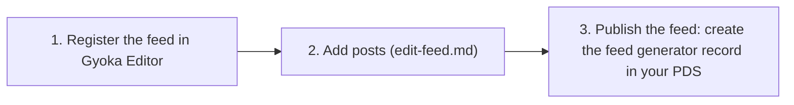

# Creating and Managing Feeds

This guide shows how to register a new feed in Gyoka, fill it with posts, and publish it on Bluesky.
To add posts in detail, see [edit-feed.md](edit-feed.md).

## Overview

Publish the feed **last**. After the feed record exists in your PDS, anyone can find and open the feed.
Register the feed and add posts first, so that users see content from the start.



| Step | Where        | Result                                                      |
| ---- | ------------ | ----------------------------------------------------------- |
| 1    | Gyoka Editor | Gyoka Generator knows the feed URI. The feed is not public. |
| 2    | Gyoka Editor | The feed has posts to show.                                 |
| 3    | Your PDS     | The feed appears on Bluesky and users can open it.          |

## Before you start

- Gyoka Generator and Gyoka Editor are deployed. See [Deploy to Production](../README.md#deploy-to-production).
- You know these values:

  | Value                   | Where to find it                                                             |
  | ----------------------- | ---------------------------------------------------------------------------- |
  | `FEEDGEN_HOST`          | `vars` in `packages/generator/wrangler.jsonc`                                |
  | `FEEDGEN_PUBLISHER_DID` | `vars` in `packages/generator/wrangler.jsonc`                                |
  | `GYOKA_EDITOR_HOST`     | `vars` in `packages/editor/wrangler.jsonc`                                   |
  | Your PDS URL            | The server your Bluesky account lives on (for example `https://bsky.social`) |
  | Your administrator DID  | Must be listed in `GYOKA_EDITOR_ADMIN_DIDS` of the editor                    |

## Step 1. Register the feed in Gyoka Editor

### 1-1. Prepare to call the Editor API

Gyoka Editor accepts only authenticated [XRPC](https://atproto.com/specs/xrpc#authentication) requests.
[goat](https://github.com/bluesky-social/goat) sends them through your PDS (Service Proxying) and handles authentication for you.
The account you log in with must be listed in `GYOKA_EDITOR_ADMIN_DIDS`.

1. Log in. Use an [app password](https://bsky.app/settings/app-passwords).

   ```bash
   goat account login -u your-handle.example.com -p your-app-password
   ```

2. Set the editor as a variable. Every example in this guide and in [edit-feed.md](edit-feed.md) uses `$GYOKA_EDITOR`.

   ```bash
   # did:web:{GYOKA_EDITOR_HOST}#gyoka_editor
   export GYOKA_EDITOR="did:web:feed-editor.your-subdomain.workers.dev#gyoka_editor"
   ```

3. Check that the editor is reachable and that you are allowed to use it.

   ```bash
   goat xrpc query "$GYOKA_EDITOR" net.nusno.gyoka.ping
   # {"message":"Gyoka is available"}
   ```

   `goat xrpc <query|procedure> <service> <nsid> [args...]` calls an XRPC method.
   Use `query` for GET methods and `procedure` for POST methods.
   Arguments use [HTTPie](https://httpie.io/docs/cli/request-items) syntax:

   | Argument     | Meaning                                    |
   | ------------ | ------------------------------------------ |
   | `key==value` | Query parameter (GET)                      |
   | `key=value`  | JSON body, string field                    |
   | `key:=value` | JSON body, non-string field (`true`, `10`) |
   | `-`          | Read the whole JSON body from stdin        |

> [!TIP]
> For local development, set `GYOKA_EDITOR_AUTH_REQUIRED` to `disabled` and call the editor directly by URL.
> For example: `goat xrpc query http://localhost:5173 net.nusno.gyoka.ping`.
> Never disable authentication in production.

### 1-2. Decide the feed URI

The feed URI has this format. You choose the record key now, and use the same key in [step 3](#step-3-publish-the-feed).

```text
at://{FEEDGEN_PUBLISHER_DID}/app.bsky.feed.generator/{record-key}
```

Example: `at://did:plc:your-did/app.bsky.feed.generator/my-feed`

### 1-3. Register the feed

```bash
goat xrpc procedure "$GYOKA_EDITOR" net.nusno.gyoka.feed.registerFeed \
  uri=at://did:plc:your-did/app.bsky.feed.generator/my-feed \
  langFilter:=false \
  isActive:=true
```

| Field        | Required | Default | Description                                                                                                                                                   |
| ------------ | -------- | ------- | ------------------------------------------------------------------------------------------------------------------------------------------------------------- |
| `uri`        | Yes      | -       | Feed URI from step 1-2. It must use a DID. Handles are not accepted.                                                                                          |
| `langFilter` | No       | `true`  | If `true`, the generator returns only posts that match the `Accept-Language` header of the request (up to 10 primary tags) or are marked `*` (all languages). |
| `isActive`   | No       | `true`  | If `false`, the generator returns no posts for this feed.                                                                                                     |

Response:

```json
{
  "message": "Feed registered successfully",
  "feed": {
    "uri": "at://did:plc:your-did/app.bsky.feed.generator/my-feed",
    "orderRevision": 0,
    "langFilter": false,
    "isActive": true
  }
}
```

`orderRevision` counts changes to the post list of the feed. It starts at `0`.
See [Order revision](edit-feed.md#order-revision).

> [!NOTE]
> Each feed URI can be registered only once. A duplicate request returns `Conflict`.

Check that the feed is listed.

```bash
goat xrpc query "$GYOKA_EDITOR" net.nusno.gyoka.feed.listFeeds
```

## Step 2. Add posts

Add the first posts to the feed: [edit-feed.md](edit-feed.md).

Confirm that the posts are stored.

```bash
goat xrpc query "$GYOKA_EDITOR" net.nusno.gyoka.feed.listPosts \
  feed==at://did:plc:your-did/app.bsky.feed.generator/my-feed
```

## Step 3. Publish the feed

Create an `app.bsky.feed.generator` record in your PDS.
After this step the feed is public on Bluesky.
It tells Bluesky the name of the feed and which service serves it.

Important values:

- Record key: the `{record-key}` you chose in [step 1-2](#1-2-decide-the-feed-uri). The resulting feed URI must be exactly the one you registered.
- Service DID: `did:web:{FEEDGEN_HOST}`
- `acceptsInteractions`: `false` **(required)**. Gyoka does not support feed interactions. Do not set it to `true`.
- The account that owns the record must be the account set in `FEEDGEN_PUBLISHER_DID` of the generator.

### Option 1: Official publishing script

1. Clone the [official feed generator starter kit](https://github.com/bluesky-social/feed-generator).
2. Follow its [publishing instructions](https://github.com/bluesky-social/feed-generator?tab=readme-ov-file#publishing-your-feed).
3. Set `FEEDGEN_SERVICE_DID` to `did:web:{FEEDGEN_HOST}`, and the record name to `{record-key}`.

### Option 2: Create the record directly

Call [`com.atproto.repo.createRecord`](https://docs.bsky.app/docs/api/com-atproto-repo-create-record) on your PDS.
Use the [`app.bsky.feed.generator` lexicon](https://github.com/bluesky-social/bsky/blob/main/lexicons/app/bsky/feed/generator.json) for the record.

Minimum example with [goat](https://github.com/bluesky-social/goat), an AT Protocol CLI:

1. Log in with the account that publishes the feed (`FEEDGEN_PUBLISHER_DID`).
   If you already logged in with this account in [step 1-1](#1-1-prepare-to-call-the-editor-api), skip this.

   ```bash
   goat account login -u your-handle.example.com -p your-app-password
   ```

2. Write the record to `feed-generator.json`.

   ```json
   {
     "$type": "app.bsky.feed.generator",
     "did": "did:web:{FEEDGEN_HOST}",
     "displayName": "My Feed",
     "description": "Describe your feed here.",
     "acceptsInteractions": false,
     "createdAt": "2026-01-01T00:00:00.000Z"
   }
   ```

   > [!IMPORTANT]
   > `acceptsInteractions` must be `false`. Do not change it or remove it.

3. Create the record. `--rkey` is the `{record-key}` of the feed URI.

   ```bash
   goat record create --rkey my-feed feed-generator.json
   ```

   The command prints the AT URI of the new record. Check that it is the feed URI you registered in step 1.

### Verify

Open the feed in the Bluesky app, or call the generator with goat.
When `FEEDGEN_AUTH_REQUIRED` is `enabled`, the generator requires a service JWT.
goat creates it for you when you call the generator by its service DID.

```bash
goat xrpc query "did:web:{FEEDGEN_HOST}#bsky_fg" app.bsky.feed.getFeedSkeleton \
  feed==at://did:plc:your-did/app.bsky.feed.generator/my-feed
```

The response lists post URIs of the feed (`feed[].post`).

## Managing registered feeds

| Task                               | Method                                 | Notes                                                     |
| ---------------------------------- | -------------------------------------- | --------------------------------------------------------- |
| List all feeds                     | `net.nusno.gyoka.feed.listFeeds` (GET) | Returns `uri`, `orderRevision`, `langFilter`, `isActive`. |
| Change `langFilter` or `isActive`  | `net.nusno.gyoka.feed.updateFeed`      | Send only the fields to change. At least one is required. |
| Delete a feed and all of its posts | `net.nusno.gyoka.feed.unregisterFeed`  | Cannot be undone.                                         |

Pause a feed without deleting its posts:

```bash
goat xrpc procedure "$GYOKA_EDITOR" net.nusno.gyoka.feed.updateFeed \
  uri=at://did:plc:your-did/app.bsky.feed.generator/my-feed \
  isActive:=false
```

Delete a feed:

```bash
goat xrpc procedure "$GYOKA_EDITOR" net.nusno.gyoka.feed.unregisterFeed \
  uri=at://did:plc:your-did/app.bsky.feed.generator/my-feed
```

`unregisterFeed` removes the registration and the posts stored in Gyoka.
The `app.bsky.feed.generator` record stays in your PDS. Delete it separately if you no longer need the feed on Bluesky.

## Errors

| Error                    | Meaning                                       | What to do                                                    |
| ------------------------ | --------------------------------------------- | ------------------------------------------------------------- |
| `AuthenticationRequired` | The token is missing or invalid.              | Run `goat account login` again and check `GYOKA_EDITOR`.      |
| `Forbidden`              | Your DID is not in `GYOKA_EDITOR_ADMIN_DIDS`. | Add the DID to the editor settings and redeploy.              |
| `BadRequest`             | Invalid input, such as a handle-based URI.    | Use `at://did:.../app.bsky.feed.generator/...`.               |
| `Conflict`               | The feed URI is already registered.           | Use `updateFeed` to change settings.                          |
| `UnknownFeed`            | The feed URI is not registered.               | Register it first, or check the URI.                          |
| `InternalServerError`    | Server-side failure.                          | Set `DEVELOPER_MODE` to `enabled` temporarily and check logs. |
